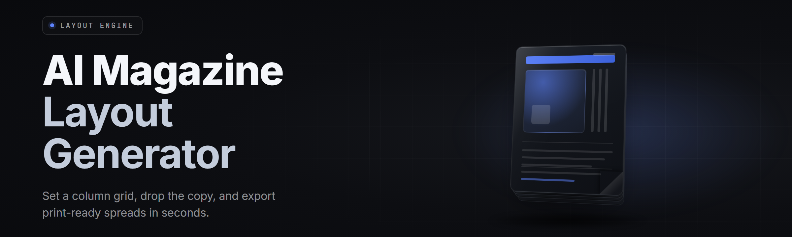

  
  
  

  

  
  

---

**Drop a manuscript in. Get a print-ready spread out.**  
AI-driven grid composer, typographic engine, and multi-page paginator for indie editors, zine makers, and design studios.

---

## 📰 Overview

AI Magazine Layout Generator Pro is a Windows desktop tool that turns raw article text, image folders, and style hints into finished magazine spreads — column grids, drop caps, pull quotes, ad blocks, folios, and bleed markers all placed automatically and re-flowable in one click.

| Category | Details |
|---|---|
| What it is | Offline AI layout engine for print + digital magazines |
| Runs on | Windows 10 / 11 x64, standalone `.exe` |
| Output | PDF/X-1a, PDF/X-4, PNG spreads, InDesign IDML export |
| Input | TXT, MD, DOCX, RTF, JPG, PNG, WEBP, TIFF, SVG |
| Engine | Constraint solver + typographic neural ranker + grid library |
| License | MIT — free for personal and commercial use |

Students, hobbyist zine builders, and small editorial teams use it because the learning curve is a drag-and-drop and the output respects grid math instead of eyeballing it.

## 🧭 Table of Contents

- [Overview](#-overview)
- [What is AI Magazine Layout Generator](#-what-is-ai-magazine-layout-generator)
- [The Problem](#-the-problem)
- [The Solution](#-the-solution)
- [Key Features](#-key-features)
- [Comparison](#-comparison)
- [Module Status](#-all-modules-status)
- [Module Catalog](#-grouped-module-catalog)
- [Tips for Best Results](#-tips-for-best-results)
- [Quick Start](#-quick-start)
- [Installation](#-installation)
- [System Requirements](#-system-requirements)
- [Compatibility](#-compatibility--platform-support)
- [Known Issues](#-known-issues)
- [Usage Guidelines](#-usage-guidelines)
- [Changelog](#-changelog)
- [FAQ](#-faq)

---

## 📚 What is AI Magazine Layout Generator

A layout engine that reads content intent — article density, image aspect ratios, caption length, pull-quote candidates — and stacks them onto grids that respect typographic hierarchy, gutter math, and print constraints.

| Term | Explanation |
|---|---|
| Grid | Column structure (3, 4, 5, 6 cols, custom) with baseline alignment |
| Baseline grid | Invisible horizontal rhythm every text block snaps to |
| Spread | Two facing pages, the atomic layout unit in print |
| Bleed | 3mm overprint area to survive trimming |
| Folio | Page number + running head placement |
| Filler | Auto-flow block that expands to close white space |
| IDML | Adobe InDesign interchange format for hand edits |

Benefits of this approach:

- **Deterministic typography** — every spread obeys one baseline grid, no drift between pages.
- **One-file workflow** — script in, packaged PDF out; no external DTP suite required.
- **Re-flowable** — swap a photo, whole spread recomposes without breaking keylines.
- **Print-safe by default** — CMYK profiles, crop marks, bleed, spot color separations.
- **Style memory** — save mastheads, rubrics, and section furniture as reusable presets.

## 🩹 The Problem

- **Templates fight back.** Microsoft Publisher grids disintegrate the second a 12-inch photo hits a 3-column page.
- **InDesign is heavy.** It costs, it needs a licence, and a 40-page zine build eats an afternoon.
- **Manual gutter math is agony.** Aligning every caption to the baseline grid by hand never once ended clean.
- **Stock AI image tools** don't understand spreads, gutters, or trim — they make pretty rectangles.
- **Rebranding a 60-page issue** means retyping every folio, by hand, forever.
- **Multi-format export is a wrap.**

### ⬇️ Get the Build

  

## 🧴 The Solution

| Problem | Solution |
|---|---|
| Templates collapse on odd image ratio | Constraint solver re-grids per page |
| InDesign licence + heavy install | Single offline `.exe`, no cloud, no account |
| Manual baseline alignment | Auto-snap on import, one toggle to shift whole issue |
| AI generators ignore print geometry | Dedicated spread model, bleed + trim native |
| Rebranding is manual | Style presets + global find/replace of furniture |
| Multi-format export | One render carousel → PDF/X, PNG, IDML |

## 🎛️ Key Features

| Feature | Description | Benefit |
|---|---|---|
| Auto-Grid Composer | Places content on nearest valid grid instantly | Zero blank spread drafting |
| Typographic Ranker | Scores headline vs body weight per article | Reads like a pro pulled it |
| Pull Quote Picker | Pulls three hottest lines from body copy | Editorial flavour in one click |
| Image Sizer | Crops and fits to aspect budget per column | No more stretched photos |
| Color Harmonizer | Extracts palette from cover to seed spreads | Entire issue feels branded |
| Bleed Guard | Flags anything within 3mm of trim | No cut-off text after print |
| Folio Engine | Auto-numbers + places running heads | Editorial polish for free |
| Ad Slot Filler | Drops 1/4, 1/2 and full-page ads into galleys | Commercial magazine ready |
| IDML Export | Ships to InDesign for hand-tweaking | Editors keep control |
| Ink Reducer | Thins CMYK coverage on photo-heavy spreads | Cheaper offline pricing |
| Style Memory | Save any spread as a preset | Reuse beats re-build |
| Live Preview | Renders at half-res above the fold | No guessing |

## 🧱 Grouped Module Catalog

### 📐 Grid & Composition
- **Auto-Grid Composer** — solves for valid column count per page in <40ms.
- **Baseline Snapper** — locks every text block to a shared rhythm.
- **Spread Balancer** — moves blocks across a spread to equalise weight.
- **Filler Expander** — inserts whitespace rags when content is short.

### 🔤 Typography
- **Type Stack Loader** — pulls Google Fonts + system pairs into a bundle.
- **Drop Cap Engine** — sizes cap height to the baseline grid exactly.
- **Hyphenation Manager** — language-aware; controls orphan/widow count.
- **Kerning Assist** — fixes 200 worst pairs in a loaded style.

### 🖼️ Imagery
- **Crop Intelligence** — uses face + salience detection on subjects.
- **Aspect Budgeter** — enforces per-column ratio constraints.
- **Caption Runner** — attaches and wraps captions to the correct column.
- **Duotone Mapper** — one-click duotone from a chosen accent.

### 🎨 Colour & Finish
- **Palette Extractor** — pulls 5 anchors from any key image.
- **Spot Separation** — adds overprint spot colour layers for print.
- **Ink Reducer** — max-total-ink compliance profiles (SWOP, GRACoL).

### 🧾 Output & Delivery
- **PDF/X Packager** — cyan-safe, crop-marked, embed-all deliverable.
- **IDML Bridge** — hands editable layers to InDesign teams.
- **Spread Rasterizer** — PNG grids for newsletters or web.
- **Preflight Report** — a text summary of every flagged issue.

### 🧩 Workflow & UX
- **Style Memory** — reusable spread and furniture presets.
- **Live Preview Panel** — half-res render on change.
- **Session Log** — every action recorded, undo-anything-scope.

## ⚙️ All Modules Status

| Module | Status | Description |
|---|---|---|
| Auto-Grid Composer | ✅ Working | Live constraint solver, v2 core |
| Pull Quote Picker | ✅ Working | Extracts via text-rank scoring |
| Crop Intelligence | ✅ Working | Salience + face detection |
| Bleed Guard | ✅ Working | Flags anything near trim line |
| IDML Bridge | ✅ Working | Exports simple editable layers |
| Ink Reducer | ⚠️ Beta | ICC profiles shipping June 2026 |
| Duotone Mapper | 🧪 Preview | Full release planned next cycle |
| Spot Separation | ✅ Working | CMYK + spot layer output |
| Preflight Report | ✅ Working | Text log + PDF appendix |

## 🎯 Comparison — The Old Way vs This Tool

| Aspect | Raw Publisher/Word | This Tool |
|---|---|---|
| Grid re-flow | Manual, error-prone | Solver snaps per page |
| Baseline grid | Optional, breaks often | Locked by default |
| Print setup | User must add bleed + marks | Native — always on |
| Pull quote | Human reads body first | Auto-picked from crop sentence |
| Colour | Manual swatch spread | Palette extracted from cover |
| Rebranding | Retype every folio | One global preset |
| Export | Save-As × many times | Carousel: PDF, PNG, IDML |
| Setup time | Days to print-ready | Under an hour |

## 💡 Tips for Best Results

- Feed a magazine voice first — drop a PDF spread sample and it keeps your tone.
- Keep paragraph bodies under 900 words per article for cleaner column stays.
- Use TIFF/PNG at 300 DPI; the sizer will handle odd ones but output suffers.
- Lock your bleed profile before you generate — changing it later resnaps all furniture.
- Reuse the same style preset across an issue number so folios stay consistent.
- If re-gridding feels aggressive, tune Grid Presets → Balanced to Conservative.
- Batch render overnight for 60+ spread issues — reduces peak RAM.

## 🚀 Quick Start

1. 📥 Visit the project page and download the release package.
2. 🗜️ Extract the archive to any empty folder (do **not** run from inside the zip).
3. 🛡️ Right-click the `.exe` → **Run as Administrator** (first launch only, for printer profiling).
4. 🪄 Launch the `.exe` — the wizard greets you, drop your content folder or docx.
5. ⚙️ Hit **Auto-Grid**, pick a preset, then **Export** to PDF and you're done.

## 🧊 Installation

1. **Download.** Grab the current release archive from the project page.
2. **Extract.** Right-click the archive → *Extract All...* — Windows Explorer or 7-Zip both work.
3. **Run.** Double-click the `.exe` inside the extracted folder, choose **Run as Administrator** the first time, then accept any printer profiling prompts.

## 🖥️ System Requirements

| Component | Minimum | Recommended |
|---|---|---|
| OS | Windows 10 21H2 x64 | Windows 11 23H2 x64 |
| CPU | 4-core / 2.4 GHz | 8-core / 3.2 GHz+ |
| RAM | 8 GB | 16–32 GB |
| Disk | 900 MB free | 2 GB SSD |
| GPU | DirectX 11 | DirectX 12, 4 GB VRAM |
| Display | 1366×768 | 1920×1080 or higher |

## 🔄 Compatibility / Platform Support

| Target | Supported | Notes |
|---|---|---|
| Windows 10/11 x64 | ✅ Full | Standalone `.exe`, no runtime install |
| Windows ARM64 | ⚠️ x64 emulation | Works, minor slowdown |
| macOS | ❌ | Roadmap Q4 2026 |
| Linux (Wine 9+) | ⚠️ Partial | PDF export tested, IDML untested |
| Adobe InDesign CC | ✅ | Via IDML export |
| Affinity Publisher | ✅ | Via PDF/X-4 import |
| Raspberry Pi | ❌ | Out of scope |

## 🧯 Known Issues

| Issue | Solution |
|---|---|
| Cap-Height clipped on 5-column grid | Freeze "Balanced" preset, opt into "Column-Safe" |
| Sky fonts don't render | Font used isn't OS-installed — bundle or swap |
| Bleed flags after 3–4 pages | Restart with trim profile configured |
| Slow preview at 8–10 columns | Toggle Draft-Re-side off in settings |
| Large TIFF loads stall | Convert to JPG at 300 DPI first |
| IDML glyph miss on rare fonts | Use "Wide Coverage" face in prefs |

## 🧾 Usage Guidelines

Use it for fanzines, indie mags, education packets, self-published issues, commercial house magazine work, and print mockups. Do **not** use it as a marketing-autoresponder, mass-variant ad-runner, or in any context where applying custom currency-image templates is expected. Publisher-quality output is a tool — the ethical posture of its content is yours.

## 🗒️ Changelog

- **v2.4.1 — 2026-01-14** — Fix: 5-column grid re-snapped after crop; new "Column-Safe" preset.
- **v2.4.0 — 2025-12-02** — Feature: Palette Extractor + one-click duotone.
- **v2.3.6 — 2025-10-30** — Fix: IDML export glyph coverage for sci-fi stacks.

---

  

Get the spread framed, ship the issue, and let the machine do the grid math. Free for hobbyists and pros alike — pull the latest package and drop in your manuscript. The AI Magazine Layout Generator Pro team ships updates when the community asks for them, not when a subscription asks.

## ❓ FAQ

<b>Is this really a Windows `.exe`?</b>
Yes — a single portable `.exe`. No installer, no npm, no pip. Extract → run.

<b>Do I need InDesign to use it?</b>
No. It exports print-ready PDF/X directly. IDML export is optional for teams that hand off to InDesign.

<b>Does it need internet?</b>
Only for the first font bundle download. After that it runs fully offline.

<b>Will it overwrite my InDesign file?</b>
No. IDML is a *new* file — the tool never mutates existing docs.

<b>Can I use it for commercial magazines?</b>
Yes. MIT-licensed output, commercial use fine. Only rule: don't resell the tool as your own.

<b>What output formats can I get?</b>
PDF/X-1a, PDF/X-4, PNG spreads, and IDML. PDF is the recommended print deliverable.

<b>Why does it ask for Admin on first launch?</b>
Printer colour profiles go into the Windows system spooler — needs a write there once.

<b>My 10-column grid crawls — normal?</b>
Yes on older CPUs. Turn on Draft Preview, or set CPU Throttle to 60%. Grids above 8 columns are expensive.

<b>Are my projects uploaded anywhere?</b>
No. Layout runs entirely local. Nothing touches a network unless you enable Update Check.

<b>Does it detect or report my fonts/copies?</b>
Only locally-written preflight logs in your project folder. No telemetry.

